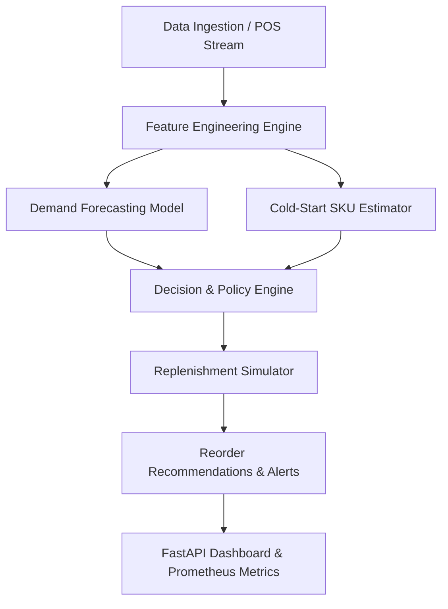

# StockGuard Architecture & System Design

## Core Subsystems
1. **Feature Engineering Engine**: Processes historical sales, lead time variance, and seasonality indices.
2. **Forecasting Service**: Dual model pipeline integrating baseline statistical models with gradient boosted regressors.
3. **Safety Stock Optimizer**: Implements King's formula and service level safety factors ($Z$-scores).
4. **Audit & Governance**: Enforces invariant validation on purchase recommendations before pushing orders.
